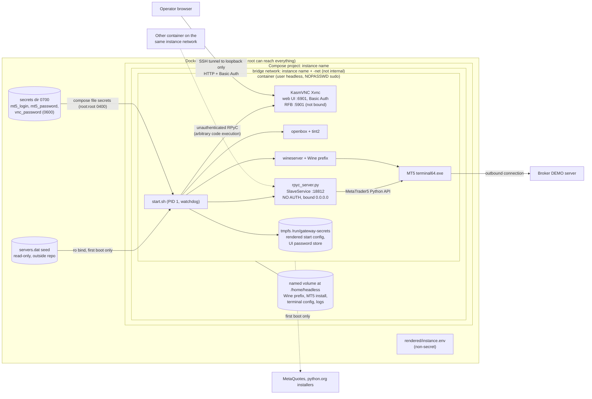
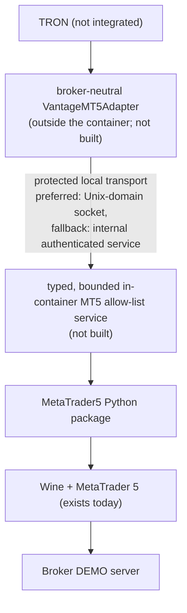

# Architecture

This page separates **what exists today** from **the accepted target (ADR-MT5-001)**. Only the first
is implemented. Sources: `Dockerfile`, `start.sh`, `bridge/rpyc_server.py`, `deploy/*.yml`, the evidence
records in [EVIDENCE-INDEX.md](EVIDENCE-INDEX.md), and the maintainers' read-only verification of the
existing DEMO instance (GOAL audit record, 2026-10-15).

## 1. What exists today

One instance is one container, one broker account, one Compose project.



ASCII fallback:

```text
 Operator browser --(SSH tunnel to loopback, HTTP + Basic Auth)--+
                                                                 v
+---------------- Docker host (host root reaches everything) ---------------------+
| secrets dir 0700 (3 files 0600)   servers.dat seed (ro, outside repo)           |
|        | compose file secrets (root:root 0400)      | ro bind, first boot only   |
|  +-----v--------------------------------------------v--------------------------+ |
|  | Compose project = instance name; bridge network <name>-net (not internal)    | |
|  |  +-- container (user headless, NOPASSWD sudo) --------------------------+   | |
|  |  | start.sh (PID 1) -> tmpfs /run/gateway-secrets (rendered config)      |   | |
|  |  |   KasmVNC Xvnc: web UI :6901 (Basic Auth, HTTP)   RFB :5901 not bound |   | |
|  |  |   openbox + tint2                                                     |   | |
|  |  |   wineserver + Wine prefix --> MT5 terminal64.exe --> broker DEMO     |   | |
|  |  |   rpyc_server.py  SlaveService :18812  NO AUTH  bound 0.0.0.0 <-------+---+-+-- any container
|  |  +---------------------------------------------------+-------------------+   | |   on this network
|  |   named volume at /home/headless (Wine prefix, MT5, config, logs) <--+       | |
|  +-------------------------------------------------------------------------------+ |
+-----------------------------------------------------------------------------------+
 Port 18812 is NOT published. The UI port is published only on a loopback address, and only if asked.
```

### Components

| Component | What it is | Where defined |
|---|---|---|
| Image | `debian:12-slim`, Wine 10.0 stable (apt-pinned), KasmVNC 1.4.0, noVNC/websockify (installed, unused by `start.sh`), user `headless` | `Dockerfile` |
| `start.sh` | 12 logged steps: Xvnc, window manager, Wine prefix, MT5 install (first boot), Wine Python 3.9.13 32-bit and pip packages (`MetaTrader5==5.0.36`, `rpyc==5.2.3`, `numpy<2`), terminal config reassertion, optional `servers.dat` seed, launch terminal, start bridge in a restart loop, then a watchdog | `start.sh` |
| Terminal | MetaTrader 5 under Wine. The installer is fetched from MetaQuotes at first boot and always yields the current build | `start.sh` step 6 |
| Terminal config | each start reasserts `AutoUpdate=0` and the Python-API gate (`Api=1`, `AllowDllImport=1`, plus `Account`, `Profile`, `Chart` set to 0) | `start.sh` `preseed_experts_and_autoupdate` |
| Bridge | `rpyc.SlaveService` with `allow_public_attrs` and `allow_all_attrs` true, `0.0.0.0:18812`, no authentication | `bridge/rpyc_server.py` |
| Browser UI | KasmVNC web client on container port 6901. Basic Auth user `matt`, password from `vnc_password`. Plain HTTP (`-sslOnly 0`). RFB security type None behind Basic Auth. The RFB port 5901 is configured but no listener binds it (WO-MT5GW-0003) | `start.sh` step 1 |
| Compose project | one service, container name = instance name, labels, limits, restart policy, own network, named volume, tmpfs, three file secrets, no `ports:` | `deploy/compose.instance.yml` |
| UI overlay | publishes container 6901 on `network.bind:<port>` (loopback only), added only when `ports.operator_ui` is a number | `deploy/compose.operator-ui.yml` |
| Secrets | three host files mounted by Compose; rendered into tmpfs by `start.sh`, never the volume | OPERATOR-GUIDE section 4 |
| Volume | named volume mounted at `/home/headless`: Wine prefix, MT5 install, terminal config and logs. Survives `docker restart` and recreate | WO-MT5GW-0006 |
| Healthcheck | `pgrep` for the terminal and the bridge process; start period 300 s, interval 30 s, 3 retries. Does not test login, ticks, environment or exposure | `Dockerfile` |
| Config tooling | `mt5ctl new/lint/render` produce and validate `instance.env`; no container contact | `tools/mt5ctl`, [CONFIG-REFERENCE.md](CONFIG-REFERENCE.md) |

### Trust boundaries and network exposure (as built)

| Boundary | Exposure | Protection | Residual risk |
|---|---|---|---|
| Host root and Docker access | full access to container, volume, secrets | host access control (outside this repo) | anyone with Docker access owns the instance |
| Browser UI | optional host port on a loopback address only (lint enforces) | Basic Auth, cleartext HTTP; use a tunnel | Basic Auth password crosses loopback/tunnel in cleartext; **fails open** if the secret is missing (H2). One pre-template instance was found bound to a LAN interface address instead of loopback (see KNOWN-LIMITATIONS) |
| Bridge port 18812 | never published. Reachable by any container on the instance network and by host root via the Docker bridge | network isolation only | unauthenticated arbitrary code execution (H3); with NOPASSWD sudo (H1) and root-readable secrets, reaching the bridge means credential access. The network is not `internal`, so a compromised container also has outbound internet |
| Container to internet | outbound for the broker, first-boot downloads (MetaQuotes, python.org, PyPI) | none | non-hermetic first boot |
| Secrets in the container | file secrets root:root 0400; rendered config on a tmpfs owned by `headless`, mode 0400 | not on the persistent volume | readable via `sudo`, and through the bridge |
| Terminal state | persistent volume; `accounts.dat` inside it is world-readable (mode 0644) in the existing instance | volume is not shared | binary account metadata, contents not examined |
| Terminal's own listeners | the terminal logs a local "MCP started" listener at each launch; its bind class was not determined | not published | uncharacterised (GOAL verification item 19) |

Log redaction: `start.sh` pipes only the credentialed terminal launch through a `sed` filter that masks
`Password=`-style values. It is not a general redaction layer, and `docs/DESIGN.md`'s statement that
redaction is "enforced" overstates it ([ERRATA.md](ERRATA.md) E5).

## 2. Target: ADR-MT5-001 (NOT IMPLEMENTED)

ADR-MT5-001 (accepted 2026-10-12) keeps the Docker/Wine/MetaTrader platform and **replaces** the raw
RPyC `SlaveService` boundary with a typed allow-list service. The broker-neutral adapter lives outside
the MT5 container.



```text
TRON -> broker-neutral adapter -> protected local transport (UDS preferred)
     -> typed in-container allow-list service -> MetaTrader5 Python package
     -> Wine + MetaTrader 5  [exists today]  -> broker DEMO
```

| Element | Today | Target |
|---|---|---|
| Boundary | raw RPyC `SlaveService`, any attribute, any call | typed operations only (read, bounded writes), caps, environment latch, idempotent client order ids; "raw unrestricted RPyC must not become the GOAL API" |
| Transport | TCP 18812 on the instance network | Unix-domain socket shared only with the adapter; internal authenticated service as fallback |
| Authentication | none | by transport protection (socket permissions) or authenticated service |
| DEMO assertion | none in the image | gateway-side environment latch |
| Image provenance | non-hermetic, unpinned installers, stale labels | reproducible, digest-pinned build |
| Verification | manual checks only | a `verify` command |
| Order lifecycle | never proven on this stack | proof required before PAPER: reads, market and pending orders, cancel, SL/TP, partial/full close, restart and reconciliation, idempotency, broker-side protection |

The target design, its operations and its increments are described in the maintainers' MT5 Instance
Template Contract (design, not approved). Nothing in this repository implements the typed service, the
socket transport, `describe`/`reconcile`, or any TRON-facing protocol.

## 3. How TRON will attach (later; not implemented)

TRON is a separate repository and has no integration with this gateway today. The intended attachment,
per ADR-MT5-001 and the contract, is that TRON never speaks RPyC to an instance:

1. TRON's configuration holds only an `instance_name`.
2. The adapter resolves that name to the instance's protected transport (a socket path under a
   sockets root, or an internal-network alias if the fallback is used).
3. A `describe` call returns the instance identity (environment, account class, versions) so the
   adapter confirms it reached the intended DEMO instance; a `reconcile` call runs before any write.
4. All writes go through the typed service. The unauthenticated bridge is retired or made unreachable
   first.

Until a typed gateway exists and passes its own proof, **neither instance nor TRON should be connected
to the bridge**; this is also the maintainers' recorded position (GOAL verification, 2026-10-15).

## 4. Related decisions

- ADR-MT5-001: reuse the container, replace the bridge (accepted, 2026-10-12).
- ADR-MT5-002: a separate legacy live-flagged executor is a P0 operational risk. It is out of scope
  here and nothing in this repository may depend on it. These records live in the maintainers' GOAL
  repository.
